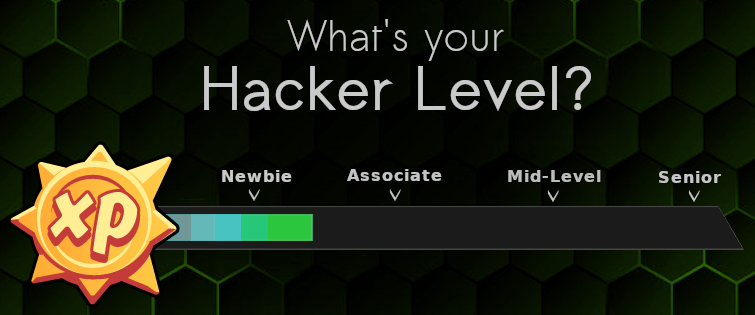

# The Ultimate Hacker Roadmap 🚀

<p align="center">
  
</p>

<div align="center">

### **From Zero to Hero. From IT Support to Principal Security Engineer and beyond.**

### **The Only Roadmap That Takes You From $30k to $250k+ in Cybersecurity**

[](https://github.com/Kennyslaboratory/Ultimate-Hacker-Roadmap/stargazers)
[](https://github.com/Kennyslaboratory/Ultimate-Hacker-Roadmap/network/members)

</div>

---

## 🎯 **Stop Wondering. Start Hacking.**

You're stuck in IT Support making $40k, watching YouTube videos about hacking, dreaming of breaking into cybersecurity. You've tried courses, certifications, and tutorials—but nothing connects the dots.

**This roadmap changes everything.**

This isn't another "learn cybersecurity" guide. This is **the definitive path** from complete beginner to Principal Security Engineer—the same path that took me from fixing printers to leading red teams at Fortune 500 companies.

**Every vulnerability. Every tool. Every technique. Every resource.**  
**Curated. Organized. Battle-tested.**

---

## 💎 **What Makes This Different?**

### **🎓 Real-World Focus**
Not theory. **Practice.** Every topic links to:
- **The best YouTube tutorials** (not random videos—the ones that actually teach)
- **Free CTF challenges** that test exactly what you're learning
- **Hands-on labs** from PortSwigger, TryHackMe, HackTheBox
- **Quality resources** vetted by working professionals

### **📊 Organized Tables**
No more scrolling through walls of text. Every concept is organized in tables with:
- **What it is** (clear description)
- **Best tutorial** (the video that actually explains it)
- **Practice lab** (where to test your skills)
- **Real-world application** (why it matters)

### **🔥 2025 Edition**
Completely overhauled for 2025:
- ✅ Modern attack vectors (HTTP Request Smuggling, Cache Poisoning, AI-augmented pentesting)
- ✅ Updated OWASP Top 10
- ✅ Cloud security (AWS, Azure, GCP)
- ✅ AI-driven penetration testing frameworks
- ✅ Zero-day research methodologies
- ✅ New Principal level for industry leaders

### **⚡ The Vulnerability Framework**
Before moving to the next vulnerability, master these 4 aspects:
1. **Find** - How do you discover it?
2. **Exploit** - How do you exploit it?
3. **Fix** - What are the modern fixes?
4. **Bypass** - How do you bypass weak mitigations?

**This framework alone will make you better than 90% of pentesters.**

---

## 🏆 **The Path: 6 Levels to Mastery**

### **Level 0: Clueless** → **Level 5: Principal**

| Level | Role | Salary Range | Timeline | Focus |
|-------|------|--------------|----------|-------|
| **[x00: Clueless](x00_Clueless)** | IT Support Specialist | $30k - $45k | 6-12 months | Hardware, OS, Networking fundamentals |
| **[x01: Newbie](x01_Newbie)** | Associate Pentester | $50k - $80k | 12-18 months | **80% Web App Security** - OWASP Top 10 mastery |
| **[x02: Associate](x02_Associate)** | Junior Pentester | $80k - $90k | 18-24 months | The Big 4: Web, Network, Binary, Mobile |
| **[x03: Mid-Level](x03_Mid-Level)** | Security Consultant | $95k - $120k | 2-3 years | Cloud security, advanced exploitation, specialization |
| **[x04: Senior](x04_Senior)** | Senior Security Engineer | $120k - $150k | 3-5 years | Research, conferences, advanced techniques |
| **[x05: Principal](x05_Principal)** | Principal/Architect | $150k - $250k+ | 5-10 years | Leadership, zero-day research, industry shaping |

---

## 🎯 **Start Here**

### **Not a penetration tester yet?**
→ Start at **[x00_Clueless](x00_Clueless)** - Master IT fundamentals first.

### **Already in IT Support?**
→ Jump to **[x01_Newbie](x01_Newbie)** - This is where the real hacking begins.

### **Already a pentester?**
→ Find your level and level up. Each level builds on the previous.

---

## 📚 **What You'll Master**

### **🔴 Web Application Security** (80% of pentesting work)
- OWASP Top 10 (2021) - Every vulnerability, every bypass
- Modern attacks: HTTP Request Smuggling, Cache Poisoning, SSRF, SSTI
- Burp Suite mastery: Proxy, Repeater, Intruder, Scanner
- Authentication bypasses, authorization flaws, session hijacking
- **Practice:** 50+ PortSwigger labs, TryHackMe web path

### **⚫ Binary Exploitation & Reverse Engineering**
- Stack overflows, heap exploitation, ROP chains
- Bypassing DEP, ASLR, Stack Canaries, CFI
- Reverse engineering with Ghidra, IDA Pro, Binary Ninja
- Exploit development from scratch
- **Practice:** pwnable.kr, Exploit Education, ROP Emporium

### **📱 Mobile Application Security**
- Android/iOS app assessment
- Frida dynamic analysis
- OWASP Mobile Top 10
- Jailbreaking/rooting for security testing
- **Practice:** Mobile security labs, vulnerable apps

### **☁️ Cloud Security**
- AWS, Azure, GCP security assessment
- IAM misconfigurations, S3 bucket vulnerabilities
- Container security (Docker, Kubernetes)
- Serverless security (Lambda, Functions)
- **Practice:** Flaws.cloud, CloudGoat, Azure Goat

### **🤖 AI-Augmented Penetration Testing**
- LLM-driven autonomous pentesting
- AI-powered fuzzing and vulnerability discovery
- Adversarial AI and ML model security
- **Practice:** RapidPen, PenTest++, custom AI agents

### **🔬 Zero-Day Research**
- Vulnerability discovery methodologies
- Exploit development and weaponization
- Responsible disclosure and CVE assignment
- **Practice:** Bug bounty programs, research projects

---

## 🛠️ **Tools You'll Master**

| Category | Tools | Why It Matters |
|----------|-------|----------------|
| **Web Testing** | Burp Suite, OWASP ZAP, SQLmap, WPScan | 80% of pentesting work is web apps |
| **Network Testing** | Nmap, Metasploit, Wireshark, Netcat | Network security is foundational |
| **Binary Analysis** | Ghidra, IDA Pro, Binary Ninja, GDB | Reverse engineering is advanced |
| **Mobile Testing** | Frida, MobSF, APKTool, jadx | Mobile apps are everywhere |
| **Cloud Security** | Scout Suite, Prowler, CloudSploit | Cloud is the future |
| **Password Cracking** | Hashcat, John the Ripper | Still relevant in 2025 |

---

## 🎓 **Certifications That Matter**

| Certification | Level | Why Get It | Cost |
|---------------|-------|------------|------|
| **CompTIA Security+** | Entry | HR filter, foundational knowledge | ~$370 |
| **CompTIA PenTest+** | Entry | General pentesting overview | ~$392 |
| **eJPT** | Entry | Practical, hands-on, affordable | ~$200 |
| **OSCP** | Associate | The gold standard, hands-on | ~$1,499 |
| **OSEP** | Mid-Level | Advanced Windows exploitation | ~$1,499 |
| **GXPN** | Senior | Exploit research and advanced pentesting | ~$7,000 |
| **OSEE** | Principal | Advanced Windows exploitation expert | ~$1,499 |

**Pro Tip:** Don't collect certifications like Pokémon. Get them strategically based on your career goals.

---

## 🚀 **Practice Platforms**

| Platform | Best For | Cost | Why Use It |
|----------|----------|------|------------|
| **[PortSwigger Web Security Academy](https://portswigger.net/web-security)** | Web app security | **FREE** | Best web security labs, created by Burp Suite makers |
| **[TryHackMe](https://tryhackme.com/)** | Beginners | Free + Premium | Guided learning paths, beginner-friendly |
| **[HackTheBox](https://www.hackthebox.com/)** | Intermediate/Advanced | Free + Premium | Realistic machines, active community |
| **[pwnable.kr](http://pwnable.kr/)** | Binary exploitation | **FREE** | Best binary exploitation challenges |
| **[Exploit Education](https://exploit.education/)** | Binary exploitation | **FREE** | Phoenix, Nebula, Fusion challenges |
| **[PentesterLab](https://pentesterlab.com/)** | Web application security | **FREE** | Hands-on web security exercises and challenges |

---

## 💰 **The ROI: Salary Progression**

```
Level 0 (Clueless):     $30k  →  Level 1 (Newbie):     $50k  (+67%)
Level 1 (Newbie):       $50k  →  Level 2 (Associate):  $80k  (+60%)
Level 2 (Associate):    $80k  →  Level 3 (Mid-Level):  $100k (+25%)
Level 3 (Mid-Level):    $100k →  Level 4 (Senior):     $135k (+35%)
Level 4 (Senior):       $135k →  Level 5 (Principal):   $200k (+48%)

Total Career Growth: $30k → $200k+ (567% increase)
```

**This isn't just a roadmap. It's a career transformation.**

---

## 🎯 **Success Stories Framework**

**Before:** IT Support Specialist, $40k/year, fixing printers, bored  
**After:** Principal Security Engineer, $200k+/year, leading red teams, speaking at DEF CON

**The difference?**  
→ Following a structured path instead of random tutorials  
→ Focusing on what matters (80% web app security)  
→ Practicing on real labs, not just watching videos  
→ Building a portfolio that proves your skills

---

## 📖 **How to Use This Roadmap**

1. **Find Your Level** - Be honest about where you are
2. **Master Each Topic** - Use the Find/Exploit/Fix/Bypass framework
3. **Practice Relentlessly** - Complete the labs, solve the CTFs
4. **Build a Portfolio** - Document your journey, write-ups, tools
5. **Level Up** - Move to the next level only when you've mastered the current one

**Pro Tip:** Don't skip levels. Each builds on the previous. Mastery > Speed.

---

## 🌟 **Why This Roadmap Exists**

I spent 5 years figuring this out the hard way. Random tutorials. Scattered resources. No clear path. I made every mistake possible.

**You don't have to.**

This roadmap is everything I wish I had when I started. Every resource vetted. Every path tested. Every link verified.

**Use it. Master it. Own it.**

---

## 🤝 **Contributing**

Found a broken link? Know a better resource? Want to add something?

**Pull requests welcome.** This roadmap is a living document, constantly improving.

---

## 📊 **2025 Edition Highlights**

- ✅ **Completely overhauled** with modern 2025 content
- ✅ **Organized tables** for every topic
- ✅ **Curated resources** - only the best tutorials and labs
- ✅ **Direct links** to YouTube videos, CTF challenges, practice platforms
- ✅ **New Principal level** for industry leaders
- ✅ **AI-augmented pentesting** section
- ✅ **Cloud security** deep dive
- ✅ **Zero-day research** methodologies

---

## 🎯 **Ready to Start?**

### **Begin Your Journey:**

1. **[Start at Level 0](x00_Clueless)** if you're new to IT
2. **[Jump to Level 1](x01_Newbie)** if you're already in IT Support
3. **[Find Your Level](x02_Associate)** if you're already a pentester

### **The Path is Clear. The Resources are Curated. The Success is Yours.**

---

<div align="center">

### **⭐ Star this repo if this roadmap helps you level up**

### **🚀 Fork it, customize it, make it yours**

### **💬 Share your success stories**

---

**Built by hackers. For hackers. With ❤️**

**Last Updated:** January 2025  
**Contributors:** [Your Name Here]  
**Issues:** [Report Issues](https://github.com/Kennyslaboratory/Ultimate-Hacker-Roadmap/issues)

</div>

---

## 📜 **License**

This project is licensed under the MIT License - see the LICENSE file for details.

---

<p align="center">
  <strong>From Zero to Hero. From $30k to $250k+. One Roadmap.</strong>
</p>
